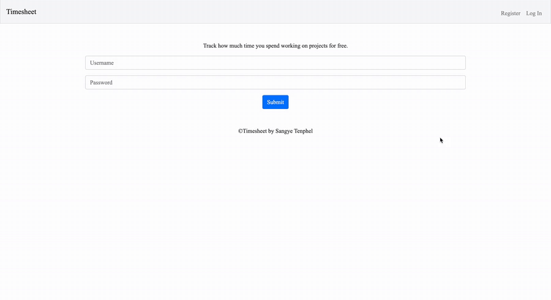

# Timesheet

A Flask web app for keeping track of hours worked. You create an account, add the places you work with their hourly base pay, and then fill in a start and end time for each day of the week. The app works out each day's pay and the total for the week, and stores everything in a SQLite database.



▶️ **[Watch the full demo video](https://sangye-tenphel.s3.amazonaws.com/timesheet.mp4)** (1 minute 21 seconds)

## Features

- **Accounts:** register with a username and password, then log in and out. Passwords are stored as salted hashes (Werkzeug), never as plain text.
- **Multiple workplaces:** add as many workplaces as you like, each with its own base pay per hour. They are listed on the home page in different colors.
- **Weekly timesheet:** each workplace has a page for the current week (Monday to Sunday) with a start time and end time field for every day.
- **Automatic saving:** after you enter an end time and leave the field, the week is saved without pressing a button.
- **Pay calculation:** each day's pay is the hours worked times the base pay, and the week's total is shown at the bottom of the table. A shift that ends after midnight (for example 5:45 PM to 8:49 AM) is counted as an overnight shift.
- **Past weeks:** the **Filter Date** picker shows the week that contains a chosen date (the picker only allows dates in 2020, the year the app was written). Weeks other than the current one are shown read-only.
- **Error pages:** missing fields, a taken username, mismatched passwords or a wrong login show an error message.

## How it works

1. `app.py` defines the routes: `/register`, `/login`, `/logout`, `/` (list of workplaces), `/workplace` (add a workplace) and `/week/<workplace name>` (the weekly timesheet).
2. Pages that need an account use the `login_required` decorator in `helpers.py`, which sends visitors to `/login` if no user is in the session. Sessions are stored on the server's filesystem with Flask-Session.
3. When the week page is opened, the app finds the Monday of the current week (or of the filtered date) and loads that week's rows from the `work_hours` table.
4. When the times are submitted, the app inserts or updates one row per day with the start time, end time and pay, then reloads the page. The weekly total is a `SUM(pay)` query over the week.

The database has three tables: `users` (username and password hash), `company` (workplace name and base pay for each user) and `work_hours` (date, start, end and pay for each user and workplace).

## Project structure

```
app.py              Flask app: routes, database queries and pay calculation
helpers.py          login_required decorator, apology (error page) and date filter
timesheet.db        SQLite database with the tables already created
templates/
├── layout.html     Shared page layout with the navigation bar (Bootstrap 4)
├── login.html, register.html
├── index.html      Workplace list and "Add Workplace" form
├── week.html       Weekly timesheet table, date filter and auto-submit script
└── apology.html    Error page
static/styles.css   Page styles
```

## Running it locally

The app has two dependencies, Flask and Flask-Session. It was written in 2020 with Python 3.7/3.8, and it also runs on current versions (tested with Python 3.13, Flask 3.1 and Flask-Session 0.8).

```bash
git clone https://github.com/sangyetenphel/timesheet.git
cd timesheet
python3 -m venv venv
source venv/bin/activate
pip install flask flask-session
flask run
```

Then open http://127.0.0.1:5000, register an account, and add a workplace. `timesheet.db` already contains the tables, so no setup step is needed. The pages load Bootstrap from a CDN, so the styling needs an internet connection.

## Built with

- **Backend:** Python, Flask, Flask-Session and SQLite
- **Frontend:** HTML, Jinja templates, CSS, [Bootstrap 4](https://getbootstrap.com/) and a little JavaScript

The `apology` error page and the `login_required` decorator follow the pattern used in Harvard's CS50 "Finance" problem set.

Created by Sangye Tenphel, 2020.
